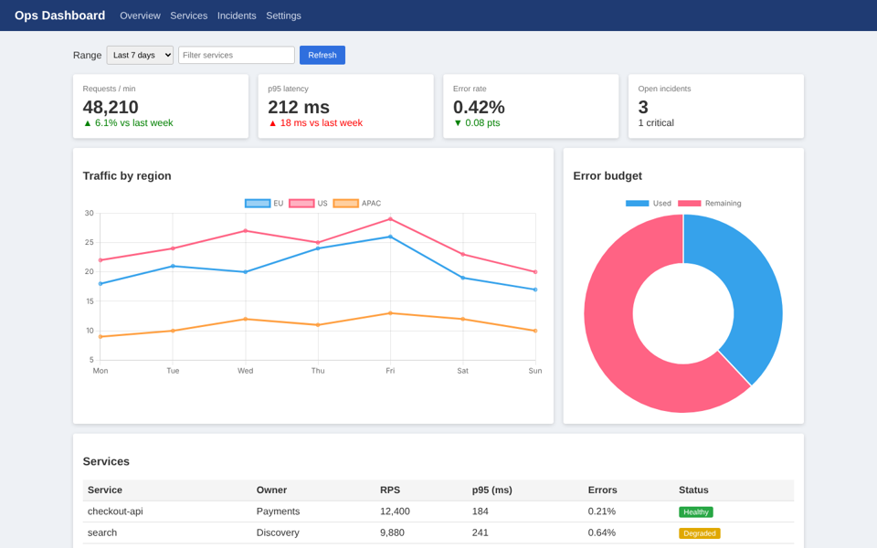
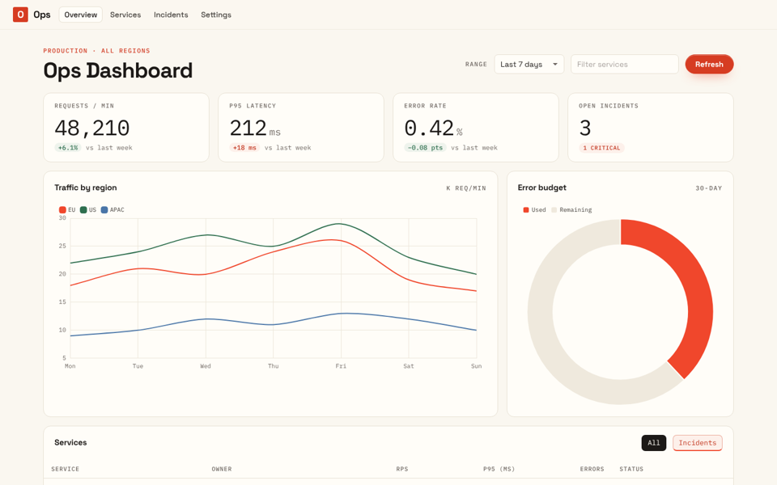
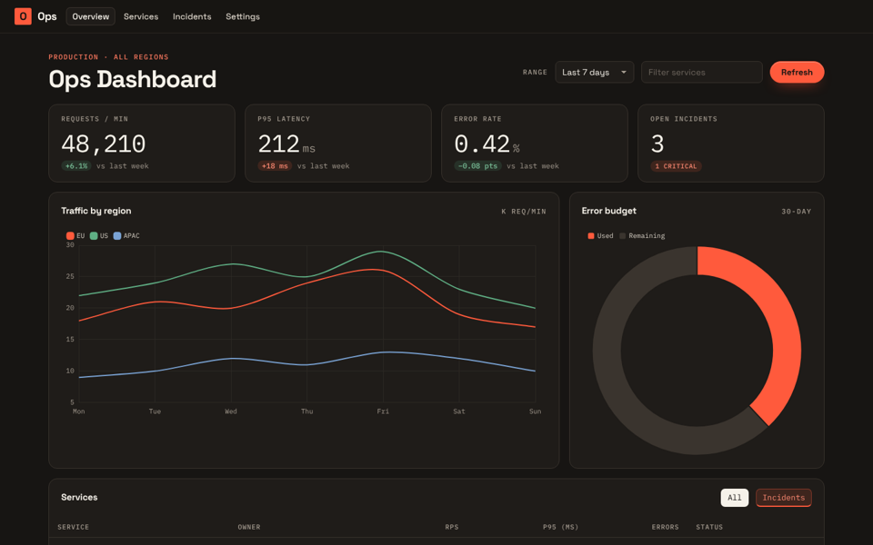

# ui-zeromark-style

A Claude Code plugin that restyles **any dashboard or web UI, in any stack**, into the zeromark visual
style: warm cream paper, near-black ink, one vermilion accent, Space Grotesk headings with IBM Plex Mono
for numbers and labels, hairline cards and keycap chips. It changes styling only, then proves it
with before/after screenshots and automated contrast and overflow checks.

| Before | After (light) | After (dark) |
|---|---|---|
|  |  |  |

Source: [`examples/dashboard-before.html`](examples/dashboard-before.html) → [`examples/dashboard-after.html`](examples/dashboard-after.html).
Same IDs, same handlers, same data.

## What's inside

| Path | What it does |
|---|---|
| `skills/zeromark-style/` | **The skill.** Workflow, style guide, per-stack recipes, assets and QA script |
| `skills/zeromark-style/assets/zeromark.css` | Drop-in stylesheet: tokens (light/dark/auto), `zm-*` components, and **adopt mode** (`<body class="zm-adopt">` restyles bare HTML) |
| `skills/zeromark-style/assets/zeromark-charts.js` | Chart themes: Chart.js, ECharts, Plotly, Highcharts, ApexCharts, Vega; raw tokens for Recharts/D3/Nivo |
| `skills/zeromark-style/assets/tailwind.preset.js` | Tailwind v3 preset (v4 `@theme` snippet in the header) |
| `skills/zeromark-style/assets/tokens.json` | All tokens as data, for Python, R, BI tools, CSS-in-JS |
| `skills/zeromark-style/reference/stack-recipes.md` | Exact setup for HTML/templates, Bootstrap, Tailwind, shadcn, MUI, Ant Design, Chakra, Vuetify, Angular Material, Svelte, Streamlit, Dash, matplotlib, ggplot/Shiny, AG Grid, Power BI, Tableau, Looker Studio, Grafana |
| `skills/zeromark-style/scripts/snap.js` | Screenshots plus a QA report: WCAG contrast failures, horizontal overflow, console errors, font loading |
| `agents/zeromark-restyler.md` | Subagent that runs the whole restyle in its own context. Run one per dashboard to restyle several in parallel |
| `skills/ui-from-reference/` | Generic version: capture **any** reference site's design tokens and screenshots to build or define a new style |

## Install

### Option A: as a plugin (recommended)
In Claude Code, in any work repo:
```
/plugin marketplace add venkatesanps/ui-zeromark-style
/plugin install zeromark-style@ui-zeromark-style
```
Updates: `/plugin marketplace update ui-zeromark-style`.
To make it available to everyone on a repo automatically, commit this to the repo's `.claude/settings.json`:
```json
{
  "extraKnownMarketplaces": {
    "ui-zeromark-style": { "source": { "source": "github", "repo": "venkatesanps/ui-zeromark-style" } }
  },
  "enabledPlugins": { "zeromark-style@ui-zeromark-style": true }
}
```

### Option B: copy the folders
```bash
git clone https://github.com/venkatesanps/ui-zeromark-style /tmp/zm
mkdir -p .claude/skills .claude/agents
cp -r /tmp/zm/skills/zeromark-style .claude/skills/          # this repo only
cp /tmp/zm/agents/zeromark-restyler.md .claude/agents/
# or into ~/.claude/skills and ~/.claude/agents to have it in every repo on your machine
```

### Option C: no Claude at all
`zeromark.css`, `zeromark-charts.js`, `tailwind.preset.js` and `tokens.json` are plain files. Copy them into
any project and follow `reference/stack-recipes.md` by hand.

## Use

Ask in plain words:
- "Apply the zeromark style to `reports/sales.html`"
- "Restyle this React dashboard in zeromark style, light and dark"
- "Use the zeromark-restyler agent on each dashboard under `dashboards/`, in parallel"
- "Theme our Streamlit app and its Plotly charts in zeromark style"

Or call it directly: `/zeromark-style:zeromark-style <target>`.

The skill detects the stack, snapshots the current UI, installs the tokens at the stack's own theme layer, maps
each component (KPI tiles, tables, filters, charts, forms, states), and verifies with `snap.js`.

### Screenshot QA needs Playwright
```bash
npm i -D playwright && npx playwright install chromium     # once per machine/project
node <skill>/scripts/snap.js http://localhost:3000/dashboard design-qa/after --full --widths 1440,390
```
Behind a proxy, or with Chrome already installed, set `CHROMIUM_PATH=/path/to/chrome`. Without
Playwright the skill still works, but you check the result by eye.

### Corporate networks
Google Fonts blocked? `npm i @fontsource/space-grotesk @fontsource/ibm-plex-mono`, or self-host the woff2 files.
The CSS falls back to system fonts cleanly.

## Notes
- The light palette and type were measured from zeromark.io; the dark theme is derived.
- One deliberate deviation: the button fill is `#d63c22` instead of `#f0472c`, so white text passes WCAG AA (4.6:1 vs 3.7:1).
- This is a visual *style*. Don't use zeromark's name, logo, illustrations or copy in your products.

MIT licence.
